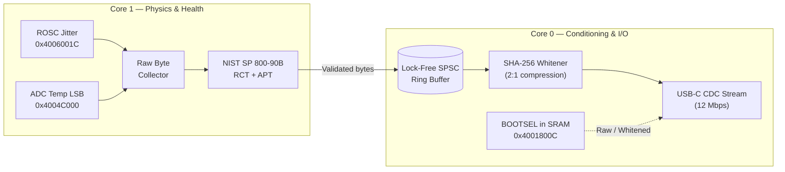

# silicon-entropy

> *Work in progress — firmware and WebSerial visualizers are being pushed incrementally.*

Dual-core **RP2040 Hardware True Random Number Generator (TRNG)** in bare-metal **Rust** (`#![no_std]`), featuring direct datasheet register access, on-chip **NIST SP 800-90B** health tests, **SHA-256** cryptographic whitening, and zero-install **WebSerial** visualizers over USB-C.

No soldering or external components required — runs on any Raspberry Pi Pico (or RP2040 clone) using only the USB port and the on-board `BOOTSEL` button.

## Architecture

## Datasheet Register Map

| Peripheral | Register | Address | Purpose |
| :--- | :--- | :--- | :--- |
| `ROSC` | `RANDOMBIT` | `0x4006001C` | Free-running ring oscillator jitter bit |
| `ADC` | `CS` / `RESULT` | `0x4004C000` | Internal temperature sensor thermal noise LSB |
| `IO_QSPI` | `GPIO_QSPI_SS_CTRL` | `0x4001800C` | Runtime `BOOTSEL` polling from SRAM |
| `SIO` | `GPIO_HI_IN` | `0xD0000008` | QSPI button state read |

## Roadmap

- [x] Hardware architecture & RP2040 datasheet register map
- [ ] Bare-metal Rust firmware (`ROSC` + `ADC`, `NIST SP 800-90B`, `SHA-256`, `USB CDC`)
- [ ] Zero-install WebSerial live visualizers (`stamps` & `architecture graph`)
- [ ] Pre-built `.uf2` release & entropy benchmarks

## License

[MIT](LICENSE)
