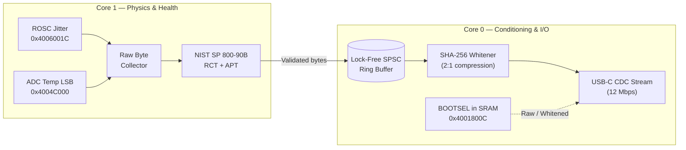

# silicon-entropy


Dual-core **RP2040 Hardware True Random Number Generator (TRNG)** in bare-metal **Rust** (`#![no_std]`), featuring direct datasheet register access, on-chip **NIST SP 800-90B** health tests, **SHA-256** cryptographic whitening, and a zero-install **WebSerial** visualizer over USB-C.

No soldering or external components required — runs on any Raspberry Pi Pico (or RP2040 clone) using only the USB port and the on-board `BOOTSEL` button.

**[Open Live WebSerial Visualizer](https://oyumly.github.io/silicon-entropy/web/)** *(Chrome, Edge, or Opera)*

## Architecture



- **Core 1** continuously samples physical jitter from the free-running Ring Oscillator (`ROSC`) mixed with the least-significant thermal noise bit of the internal `ADC` temperature sensor.
- **On-chip Health Tests (before whitening):** Repetition Count Test (RCT) and Adaptive Proportion Test (APT) run on raw bits before SHA-256 so hardware faults or stuck-at conditions are caught immediately and trigger an LED alarm.
- **Core 0** conditions validated 64-byte blocks via SHA-256 into 32 uniform bytes and streams them over USB CDC, while safely polling `BOOTSEL` from SRAM (`IO_QSPI`) to switch between **Whitened** and **Raw** modes.

## Datasheet Register Map

| Peripheral | Register | Address | Purpose |
| :--- | :--- | :--- | :--- |
| `ROSC` | `RANDOMBIT` | [`0x4006001C`](https://pip-assets.raspberrypi.com/categories/814-rp2040/documents/RP-008371-DS-1-rp2040-datasheet.pdf?disposition=inline) | Free-running ring oscillator jitter bit |
| `ADC` | `CS` / `RESULT` | [`0x4004C000`](https://pip-assets.raspberrypi.com/categories/814-rp2040/documents/RP-008371-DS-1-rp2040-datasheet.pdf?disposition=inline) | Internal temperature sensor thermal noise LSB |
| `IO_QSPI` | `GPIO_QSPI_SS_CTRL` | [`0x4001800C`](https://pip-assets.raspberrypi.com/categories/814-rp2040/documents/RP-008371-DS-1-rp2040-datasheet.pdf?disposition=inline) | Runtime `BOOTSEL` polling from SRAM |
| `SIO` | `GPIO_HI_IN` | [`0xD0000008`](https://pip-assets.raspberrypi.com/categories/814-rp2040/documents/RP-008371-DS-1-rp2040-datasheet.pdf?disposition=inline) | QSPI button state read |

## Quick Start

1. Download `silicon-entropy.uf2` from [**Releases**](https://github.com/oyumly/silicon-entropy/releases).
2. Hold `BOOTSEL` on your RP2040 board and plug it into USB — it mounts as `RPI-RP2`.
3. Drag and drop `silicon-entropy.uf2` onto `RPI-RP2`.
4. Open the [**WebSerial Visualizer**](https://oyumly.github.io/silicon-entropy/web/) and click **Connect Pico**.

Press `BOOTSEL` at any time while running to toggle between **Whitened (SHA-256)** (steady LED) and **Raw (ROSC+ADC)** (slow blinking LED).

## Build from Source

Requires Rust with the `thumbv6m-none-eabi` target and `elf2uf2-rs`:

```bash
rustup target add thumbv6m-none-eabi
cargo install elf2uf2-rs

cd firmware
cargo build --release
# Hold BOOTSEL, plug in USB, then flash:
cargo run --release
```

## USB Serial Commands

Send single-byte commands over the USB CDC port (`115200` baud):

| Command | Action |
| :--- | :--- |
| `w` | Switch to **Whitened (SHA-256)** mode |
| `r` | Switch to **Raw (ROSC+ADC)** mode |
| `1` / `0` | Start / stop binary stream |
| `p` | Toggle stream pause |
| `s` | Print JSON health telemetry |
| `u` | Reboot into `RPI-RP2` UF2 bootloader |

## License

[MIT](LICENSE)
